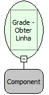

Descrição:

Essa função retorna o número da linha selecionada na grade. Informando apenas a Grade

Parâmetros:

1. Nome da Grade

Retorno:

Retorna o numero da linha selecionada.

Exemplo:

Assumindo o 1º parâmetro sendo "Sistemas". Passando esse parâmetro, ao selecionar alguma linha da Grade "Sistemas", o retorno será o número da linha selecionada.

Nome Real:

ebfGridGetSelectedRow

Compatibilidade:

Cliente
