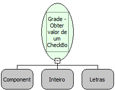

Descrição:

Essa função retorna um valor inteiro que identifica o estado do componente CheckBox na Grade, a partir da informação da linha e a coluna que deseja obter o valor.

Parâmetros:

1. Nome da Grade

2. Número da Linha

3. Nome da Coluna que se encontra o componente CheckBox

Retorno:

Número referente ao valor do check (inteiro)

0 - Desmarcado

1 - Marcado

2 - Neutro

Nome Real:

ebfGridSetCheckValue

Compatibilidade:

Cliente e Servidor
