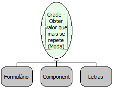

Descrição:

Moda é uma função para obter o valor que mais se repete ou que possui a maior freqüência dentro de uma coluna. Os parâmetros passados correspondem ao nome do formulário, o nome da grade e o campo que terá seus valores comparados.

Parâmetros:

1. Formulário

2. Componente Grade

3. Nome do Campo

Retorno:

Valor que mais se repete entre os valores referente ao campo informado (Inteiro)

Exemplo:

Calculando a idade da moda de uma classe de alunos a pesquisa revelou as seguintes idades: 18, 18, 19, 20, 21, 21, 22, 23, 23, 23, 24, 25, 26. A função retornará a idade que mais aparece na pesquisa. Neste caso a idade foi de 23 ano de idade.

Nome Real:

ebfModaGridColumn

Compatibilidade:

Cliente e Servidor
