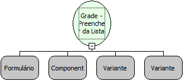

Descrição:

Preenche uma grade a partir de uma lista.

Parâmetros:

1. Formulário que contém a grade

2. Componente grade a ser alterado

3. Lista com as colunas que aparecerão na grade

4. Lista contendo os valores a serem adicionados na grade

Retorno:

Não possui.

Observações:

1. No parâmetro 4, cada linha da grade corresponde a uma lista dentro da lista desse parâmetro.

2. Após preencher a grade com esta função, não é permitido entrar em modo de inserção/edição ou gravar/excluir os registros.

3. Não é possível ordenar a grade com a funcionalidade Shift + Duplo-Clique na coluna após o uso desta função.

Nome Real:

ebfGridFillFromList

Compatibilidade:

Servidor
