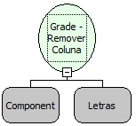

Descrição:

Essa função remove uma coluna da Grade. Passando como parâmetro a Grade e o nome da coluna que deseja remover.

Parâmetros:

1. Nome da Grade

2. Nome da Coluna

Exemplo:

Assumindo o 1º parâmetro sendo "Estado" e o 2º sendo "UF". Ao chamar à função a coluna "UF" será removida da Grade "Estado".

Observação:

Caso esta função seja utilizada em um formulário que possua barra de navegação, será necessário utiliza-la no evento "Ao Navegar" do formulário, pois ao navegar a coluna que foi removida, será exibida novamente.

Nome Real:

ebfGridRemoveColumn

Compatibilidade:

Cliente
