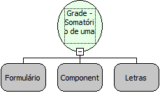

Descrição:

Essa função obtem o somatório dos os valores de um campo de uma Grade determinada e o retorna. Os parâmetros passados correspondem ao nome do formulário o nome da Grade e o campo que terá seus valores somados.

Parâmetros:

1. Nome do Formulário onde se encontra o componente grade

2. Componente grade

3. Nome da Coluna.

Retorno:

Somatório referente ao campo informado

Exemplo:

GRADE:   USUARIO

Campos: CODIGO,NOME,IDADE

No campo IDADE existe os valores: ( 18,25,14,32,30,29 )

Os parâmetros passados para a função serão:

- Nome do Formulário
- Nome da grade (USUARIO)
- Nome do campo (IDADE)

O valor retornado será: (148)

Observações:

1. A função usada no 'fluxo cliente' retorna o somatório apenas dos dados visualizados na grade, se estiver sendo usada a paginação na grade, os valores das páginas omitidas não farão parte do total obtido.

2. Os fluxos do modo Servidor contabiliza os valores principais assim como os paginados.

3. Essa função não pode ser utilizada em um fluxo servidor se for chamada a partir do evento "Ao modificar da Grade".

Nome Real:

ebfGridSumColumn

Compatibilidade:

Cliente e Servidor
