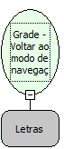

Descrição:

Volta ao modo de navegação da grade editável se ela estiver em modo de inserção ou em modo de edição.

Parâmetros:

1. Nome da grade

Retorno:

Não possui.

Observação:

A grade precisa ser editável

Nome Real:

ebfGridEditableCancel

Compatibilidade:

Cliente
