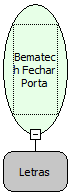

Descrição:

Essa função recebe como parâmetro uma constante do tipo letras que define a porta e libera (fecha) a mesma que está em uso pela impressora ou por outro dispositivo, para uso posterior.

Parâmetros:

Porta

Retorno:

Inteiro

Nome Real:

ebfBematechFecharPorta

Compatibilidade:

Cliente
