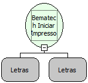

Descrição:

Inicia uma impressora Bematech através dos parâmetros passados e retorna o identificador que deverá ser usado nas chamadas subseqüentes às funções de impressão, caso haja mais de uma impressora em uso na máquina ao mesmo tempo será necessário utilizar este parâmetro.

Parâmetros:

1. Porta

2. Modelo da impressora Bematech

Retorno:

Identificador que deverá ser usado nas chamadas subseqüentes às funções de impressão.

Observação:

Esses são alguns dos modelos de impressoras Bematech

1 = MP-20 CI, MP-20 MI

2 = MP-2000 CI

3 = MP-20 TH, MP-2000 TH

4 = 58mm Kiosk Printer, 76/80mm Kiosk Printer, 112mm Kiosk Printer

Exemplo:

Bematech Iniciar Impressora

Parâmetro 1 : LPT1 (Porta).

Parâmetro 2 : MP-20 CI (Modelo da impressora Bematech).

Nome Real:

ebfBematechIniciarImpressora

Compatibilidade:

Cliente
