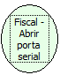

Descrição:

Abre a porta serial para comunicação entre a impressora e o micro.

Parâmetros:

Não possui

Retorno:

1: OK.

4: O arquivo de inicialização não foi encontrado no diretório de sistema do Windows.

5: Erro ao abrir a porta de comunicação.

Observações:

A função lê o nome da porta a ser aberta no arquivo de configurações. Se o parâmetro "porta" estiver configurado com a palavra "Default" a função localiza onde a impressora está conectada e configura o arquivo INI.

Nome Real:

ebfBematechFiscalOpenSerialPort

Compatibilidade:

Cliente
