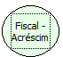

Descrição:

Retorna a valor acumulado dos acréscimos efetuados nos cupons.

Parâmetros:

Não possui

Retorno:

Valor acumulado dos acréscimos efetuados nos cupons

Nome Real:

ebfBematechFiscalAddition

Compatibilidade:

Cliente
