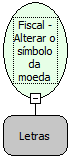

Descrição:

Altera o símbolo da moeda programada na Impressora Fiscal.

Parâmetros:

1. Moeda

Observações:

1. O $ (cifrão) é inserido automaticamente.

2. O cupom fiscal deve estar fechado.

3. Será executada somente após uma Redução Z.

4. Na impressora fiscal Bematech modelo MP-2100 TH FI, a programação do símbolo da moeda é feita somente por Intervenção Técnica.

5. Na impressora fiscal YANCO, a programação do símbolo da moeda é feita somente por Intervenção Técnica.

Retorno:

0: Erro de comunicação.

1: OK.

2: Parâmetro inválido na função.

4: O arquivo de inicialização  não foi encontrado no diretório de sistema do Windows.

5: Erro ao abrir a porta de comunicação.

27: Status da impressora diferente de 6,0,0 (ACK, ST1 e ST2).

30: Função não compatível com a impressora YANCO.

Nome Real:

ebfBematechFiscalAlterSymbolCoin

Compatibilidade:

Cliente
