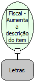

Descrição:

Esta função permite aumentar a descrição do item até 200 caracteres.

Parâmetros:

1. Descrição do item (200 caracteres)

Retorno:

0: Erro de comunicação.

1: OK.

2: Parâmetro inválido na função.

4: O arquivo de inicialização não foi encontrado no diretório de sistema do Windows.

5: Erro ao abrir a porta de comunicação.

27: Status da impressora diferente de 6,0,0 (ACK, ST1 e ST2).

30: Função não compatível com a impressora YANCO.

Observações:

1. Esta função deve ser usada antes da função Fiscal - Vender item, pois assim, o item será impresso com a nova descrição.

2. Ela tem validade somente para a impressão de um item, voltando ao default que é de 29 caracteres na descricao do item.

3. Na impressora fiscal YANCO, este comando não existe.

Nome Real:

ebfBematechFiscalIncreaseDescriptionItem

Compatibilidade:

Cliente
