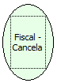

Descrição:

Retorna o valor acumulado dos itens e dos cupons cancelados

Parâmetros:

Não possui

Retorno:

Valor acumulado dos itens e dos cupons cancelados

Nome Real:

ebfBematechFiscalCancellation

Compatibilidade:

Cliente
