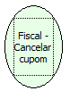

Descrição:

Cancela o último cupom emitido.

Parâmetros:

Não possui

Retorno:

0: Erro de comunicação.

1: OK.

4: O arquivo de inicialização não foi encontrado no diretório de sistema do Windows.

5: Erro ao abrir a porta de comunicação.

27: Status da impressora diferente de 6,0,0 (ACK, ST1 e ST2).

Observações:

1. No caso de cancelamento com o cupom ainda aberto, pelo menos um item deve ter sido vendido.

2. Não poderá ter ocorrido Redução Z e nem Leitura X após a emissão do cupom.

3. Na impressora fiscal YANCO, se a forma de pagamento já foi iniciada, o cancelamento do Cupom Fiscal não será executado.

Nome Real:

ebfBematechFiscalCancelCoupon

Compatibilidade:

Cliente
