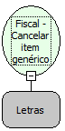

Descrição:

Cancela qualquer item dentre os cem (100) últimos itens vendidos.

Parâmetros:

1. Número do item (3 dígitos)

Retorno:

0: Erro de comunicação.

1: OK.

2: Parâmetro inválido na função.

4: O arquivo de inicialização BemaFI32.ini não foi encontrado no diretório de sistema do Windows.

5: Erro ao abrir a porta de comunicação.

27: Status da impressora diferente de 6,0,0 (ACK, ST1 e ST2).

Observações:

1. O cupom fiscal deve estar aberto

2. Ao menos um ítem deve ter sido vendido

3. O ítem não pode ter sido cancelado anteriormente e nem fora da faixa dos últimos itens vendidos.

4. Na impressora fiscal YANCO, se o item informado para o cancelamento, sofreu algum desconto, o mesmo não será cancelado. A impressora retornará "Cancelamento Não Permitido", "Comando Não Executado".

Nome Real:

ebfBematechFiscalCancelGenericItem

Compatibilidade:

Cliente
