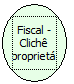

Descrição:

Retorna o clichê do proprietário cadastrado na impressora.

Parâmetros:

Não possui

Retorno:

Clichê do proprietário cadastrado na impressora

Nome Real:

ebfBematechFiscalProprietaryCliche

Compatibilidade:

Cliente
