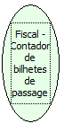

Descrição:

Retorna o número de bilhetes de passagem emitidos.

Parâmetros:

Não possui.

Retorno:

Número de bilhetes de passagem emitidos.

Obsevação:

A impressora fiscal YANCO não possui este tipo de contador.

Nome Real:

ebfBematechFiscalAccountantTicketPassage

Compatibilidade:

Cliente
