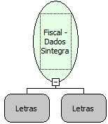

Descrição:

Esta função retorna informações da memória fiscal utilizadas na geração do relatório Sintegra.

Parâmetros:

Data inicial (Formato: ddmmaa, dd/mm/aa, ddmmaaaa ou dd/mm/aaaa)

Data final (Formato: ddmmaa, dd/mm/aa, ddmmaaaa ou dd/mm/aaaa)

Retorno:

0: Erro de comunicação.

1: OK.

2: Parâmetro inválido na função.

4: O arquivo de inicialização BemaFI32.ini não foi encontrado no diretório de sistema do Windows.

5: Erro ao abrir a porta de comunicação.

8: Erro ao criar ou gravar no arquivo STATUS.TXT ou RETORNO.TXT.

27: Status da impressora diferente de 6,0,0 (ACK, ST1 e ST2).

Observações:

1. Os campos "Situação Tributária de ICMS" e "Valor acumulado na Situação Tributária" poderão ser repetidos de acordo com o número de alíquotas utilizadas nas vendas.

2. Os campos já estão formatados no tamanho que o relatório do Sintegra exige.

3. Esta função deve ser utilizada nas impressoras fiscais matriciais (MP-20 FI II e MP-40 FI II). Para as impressoras fiscais térmicas com MFD (Memória de Fita Detalhe), utilize a função Bematech_FI_RelatorioSintegraMFD.

4. Cada linha do arquivo RETORNO.TXT corresponde a um dia de movimento na impressora.

Nome Real:

ebfBematechFiscalSintegraData

Compatibilidade:

Cliente
