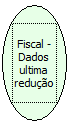

Descrição:

Retorna os dados da impressora no momento da última Redução Z.

Parâmetros:

Não possui

Retorno:

Os dados da impressora no momento da última Redução Z.

Nome Real:

ebfBematechFiscalDataLastReduction

Compatibilidade:

Cliente
