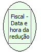

Descrição:

Retorna a data da última Redução Z.

Parâmetros:

Não possui

Retorno:

Lista de valores(Data da redução, Hora da redução)

Nome Real:

ebfBematechFiscalReductionDataTime

Compatibilidade:

Cliente
