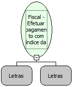

Descrição:

Imprime a(s) forma(s) de pagamento e o(s) valor(es) pago(s), através de seu(s) índice(s).

Parâmetros:

Indice da Forma de Pagamento (2 caracteres)

Valor do Pagamento (14 dígitos)

Retorno:

0: Erro de comunicação.

1: OK.

2: Parâmetro inválido na função.

4: O arquivo de inicialização BemaFI32.ini não foi encontrado no diretório de sistema do Windows.

5: Erro ao abrir a porta de comunicação.

24: Forma de pagamento não programada.

27: Status da impressora diferente de 6,0,0 (ACK, ST1 e ST2).

30: Função não compatível com a impressora YANCO.

Observações:

1. Descrição será impressa uma linha após a forma de pagamento.

2. O fechamento do cupom com formas de pagamento deve ter sido iniciado.

3. Na impressora fiscal YANCO, este comando não existe.

Nome Real:

ebfBematechFiscalMakePaymentIndexForm

Compatibilidade:

Cliente
