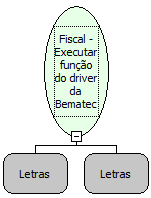

Descrição:

Executa a função da impressora bematech que foi passada como parâmetro .

Parâmetros:

1. Nome da função

2. Lista de Parâmetros da função

Retorno:

Retorno da função

Observações:

1. Os nomes das funções são os encontrados no arquivo BemaFisc.ocx disponibilizado pela empresa Bematech

2. Para mais informações consultar o site http://www.bematech.com.br/suporte

3. O limite da lista de parâmetros para da função é 12

4. Função que os parâmetros passados servem como retorno da função não funcionam

Nome Real:

ebfBematechFiscalExecuteCommand

Compatibilidade:

Cliente
