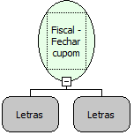

Descrição:

Permite fechar o cupom de forma resumida, ou seja, sem acréscimo ou desconto no cupom e com apenas uma forma de pagamento. Essa função lê o subtotal do cupom para fecha-lo.

Parâmetros:

1. Forma de Pagamento: (16 caracteres)

2. Mensagem

384 caracteres (8 linhas X 48 colunas) - para a impressora fiscal MP-20 FI II

320 caracteres (8 linhas X 40 colunas) - para a impressora fiscal MP-40 FI II

Retorno:

0: Erro de comunicação.

1: OK.

2: Parâmetro inválido na função.

4: O arquivo de inicialização não foi encontrado no diretório de sistema do Windows.

5: Erro ao abrir a porta de comunicação.

27: Status da impressora diferente de 6,0,0 (ACK, ST1 e ST2).

Observações:

1. O cupom deve estar aberto

2. Pelo menos 1 (um) item deve ter sido vendido e não pode ter sido cancelado

3. A utilização essa função elimina a obrigatoriedade de uso das funções "Fiscal - Iniciar fechamento de cupom", "Fiscal - Efetuar forma de pagamento" e "Fiscal - Terminar fechamento do cupom" que estão implementadas internamente na função.

4. Na impressora fiscal YANCO, se a forma de pagamento não estiver cadastrada na impressora, a função retorna erro. A programação das formas de pagamento é feita, somente, por Interveção Técnica.

Nome Real:

ebfBematechFiscalCloseSummarizedCoupon

Compatibilidade:

Cliente
