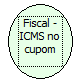

Descrição:

Retorna a valor total do ICMS pago no cupom fiscal.

Parâmetros:

Não possui

Retorno:

Total do ICMS pago no cupom fiscal.

Observação:

Para que esta função tenha efeito, a chave CalculoIcmsCupom deve existir no arquivo BemaFI32.ini, na seção [Sistema] e habilitada (CalculoIcmsCupom=1) para que a dll possa atender a solicitação na portaria 40888/07 do RJ.

Nome Real:

ebfBematechTotalICMSCoupon

Compatibilidade:

Cliente
