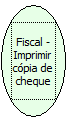

Descrição:

Imprime cópia do último cheque impresso.

Parâmetros:

Não possui

Retorno:

0: Erro de comunicação.

1: OK.

4: O arquivo de inicialização BemaFI32.ini não foi encontrado no diretório de sistema do Windows.

5: Erro ao abrir a porta de comunicação.

7: Banco não encontrado no arquivo BemaFI32.ini.

27: Status da impressora diferente de 6,0,0 (ACK, ST1 e ST2).

Observação:

Função usada somente na impressora BEMATECH MP-40 FI II e na impressora YANCO 8500.

Nome Real:

ebfBematechFiscalPrintCheckCopy

Compatibilidade:

Cliente
