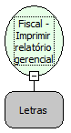

Descrição:

Imprime o relatório gerencial.

Parâmetros:

1. Texto a ser impresso no relatório (618 caracteres)

Retorno:

0: Erro de comunicação.

1: OK.

2: Parâmetro inválido na função.

4: O arquivo de inicialização não foi encontrado no diretório de sistema do Windows.

5: Erro ao abrir a porta de comunicação.

27: Status da impressora diferente de 6,0,0 (ACK, ST1 e ST2).

Observações:

1. O cupom fiscal deve estar fechado.

2. Se qualquer função diferente da "Fiscal - Fechar relatório gerencial" for chamada com o relatório aberto, efetuará seu fechamento automaticamente.

2. Na impressora fiscal YANCO o tamanho da linha é de 46 colunas.

Nome Real:

ebfBematechFiscalManagerialReport

Compatibilidade:

Cliente
