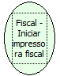

Descrição:

Inicia a impressora fiscal

Parâmetros:

Não possui

Observação:

A impressora não pode ser inicializada e utilizada no mesmo fluxo.

Nome Real:

ebfBematechBeginFiscalPrinter

Compatibilidade:

Cliente
