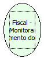

Descrição:

Retorna o número de linhas impressas após o status de Pouco Papel.

Parâmetros:

Não possui.

Retorno:

Número de linhas impressas após o status de pouco papel

Nome Real:

ebfBematechFiscalPaperMonitor

Compatibilidade:

Cliente
