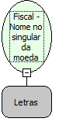

Descrição:

Programa o nome da moeda no singular para a impressão de cheques.

Parâmetro:

1. Nome da Moeda no singular (19 caracteres)

Retorno:

0: Erro de comunicação.

1: OK.

2: Parâmetro inválido na função.

4: O arquivo de inicialização BemaFI32.ini não foi encontrado no diretório de sistema do Windows.

5: Erro ao abrir a porta de comunicação.

27: Status da impressora diferente de 6,0,0 (ACK, ST1 e ST2).

Observação:

Função usada somente na impressora BEMATECH MP-40 FI II e na impressora YANCO 8500.

Nome Real:

ebfBematechSigleProgramCoinName

Compatibilidade:

Cliente
