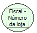

Descrição:

Retorna o número da loja cadastrado na impressora.

Parâmetros:

Não possui.

Retorno:

Número da loja cadastrado na impressora

Nome Real:

ebfBematechFiscalNumberShop

Compatibilidade:

Cliente
