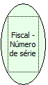

Descrição:

Retorna o número de série da impressora.

Parâmetros:

Não possui

Retorno:

Número de série da impressora

Observações:

1.  Na impressora fiscal YANCO serão retornados 10 bytes, referente ao número de série do equipamento, o restante será preenchido com espaços em branco.

2. Nas impressoras fiscais MP-2000 TH FI, MP-6000 TH FI, MP-25 FI e MP-50 FI serão retornados os 15 primeiros caracteres de seu número serial. O número serial nestas impressoras é alfanumérico com o tamanho de 20 caracteres.

Nome Real:

ebfBematechFiscalSeriesNumber

Compatibilidade:

Cliente
