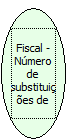

Descrição:

Retorna o número de substituições de proprietário.

Parâmetros:

Não possui

Retorno:

Número de substituições do proprietário

Nome Real:

ebfBematechFiscalnumberProprietorSubstitutions

Compatibilidade:

Cliente
