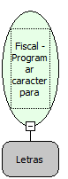

Descrição:

Programa um caracter gráfico para autenticação.

Parâmetros:

Coordenadas: (18 valores para programação do caracter gráfico, separados por vírgula)

             Ex: "001,002,004,008,016,032,064,128,064,032,016,008,004,002,129,129,129,129"

Retorno:

0: Erro de comunicação.

1: OK.

2: Parâmetro inválido na função.

3: Alíquota não programada.

4: O arquivo de inicialização não foi encontrado no diretório de sistema do Windows.

5: Erro ao abrir a porta de comunicação.

27: Status da impressora diferente de 6,0,0 (ACK, ST1 e ST2).

30: Função não compatível com a impressora YANCO.

Observações:

1. Uma vez programado, este caracter será mantido na memória da impressora mesmo que a mesma seja desligada.

2. Na impressora fiscal YANCO, esta programação não existe.

Nome Real:

ebfBematechFiscalProgramCharacterAuthentication

Compatibilidade:

Cliente
