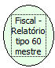

Descrição:

Gera o relatório "Tipo 60 Mestre" exigido pelo convênio de ICMS 85/2001. As informações serão geradas no arquivo RETORNO.TXT no diretório configurado no parâmetro "path" do arquivo ini. O diretório default é o diretório raiz (C:\).

Parâmetros:

Não possui

Retorno:

0: Erro de comunicação.

1: OK.

4: O arquivo de inicialização BemaFI32.ini não foi encontrado no diretório de sistema do Windows.

5: Erro ao abrir a porta de comunicação.

8: Erro ao criar ou gravar no arquivo STATUS.TXT ou RETORNO.TXT.

27: Status da impressora diferente de 6,0,0 (ACK, ST1 e ST2).

Observações:

As informações contidas no relatório Tipo 60 Mestre são alimentadas pelas funções: Bematech_FI_AberturaDoDia e Bematech_FI_FechamentoDoDia (veja essas funções para maiores informações). A função Bematech_FI_RelatorioTipo60Mestre deve ser executada após a função Bematech_FI_FechamentoDoDia() ou após a Redução Z (caso a redução tenha sido executada automaticamente pela impressora).

Nome Real:

ebfBematechFiscalMasterReportType60

Compatibilidade:

Cliente
