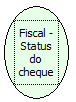

Descrição:

Verifica o status do cheque.

Parâmetros:

Não possui

Retorno:

Status do cheque

1 - Impressora ok.

2 - Cheque em impressão.

3 - Cheque posicionado.

4 - Aguardando o posicionamento do cheque.

Observações:

1. Função usada somente na impressora MP-40 FI II.

2. Na impressora fiscal YANCO, esta verificação não existe.

Nome Real:

ebfBematechFiscalVerifyStatusCheck

Compatibilidade:

Cliente
