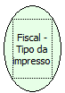

Descrição:

Retorna o tipo de impressora.

Parâmetros:

Não possui

Retorno:

1 - Impressora fiscal, gaveta, autenticaçao.

2 - Impressora fiscal, gaveta, cutter.

3 - Impressora fiscal, presenter, autenticaçao.

4 - Impressora fiscal, presenter, cutter.

5 - Impressora bilhete de passagem, gaveta, autenticaçao.

6 - Impressora bilhete de passagem, gaveta, cutter.

7 - Impressora bilhete de passagem, presenter, autenticaçao.

8 - Impressora bilhete de passagem, presenter, cutter.

Nome Real:

ebfBematechFiscalVerifyPrinterType

Compatibilidade:

Cliente
