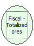

Descrição:

Retorna os totalizadores parciais cadastrados na impressora com as seguintes informações

Parâmetros:

Não possui

Retorno:

Os totalizadores parciais cadastrados na impressora com as seguintes informações

Observação:

São retornadas as seguintes informações separadas por vírgulas:

Totalizadores parciais tributados..........: 224 bytes

Isenção....................................: 14 bytes

Não incidência.............................: 14 bytes

Substitução................................: 14 bytes

Totalizadores parciais não sujeitos ao ICMS: 126 bytes

Sangria....................................: 14 bytes

Suprimento.................................: 14 bytes

Grande Total...............................: 18 bytes

Nome Real:

ebfBematechFiscalVerifyTotalizatorPartial

Compatibilidade:

Cliente
