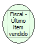

Descrição:

Retorna o número do último item vendido.

Parâmetros:

Não possui

Retorno:

Número do último item vendido.

Observação:

Na impressora fiscal YANCO, este retorno não existe.

Nome Real:

ebfBematechLastSoldItem

Compatibilidade:

Cliente
