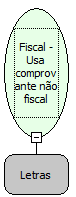

Descrição:

Imprime o comprovante não fiscal vinculado travando e destravando automaticamente o teclado e o mouse. Esta função pode ser utlizada para a impressão do texto da transação TEF. Não é necessário usar nenhuma outra função ou API do Windows para travar o teclado e o mouse.

Parâmetros:

1. Texto a ser impresso no comprovante não fiscal vinculado (618 caracteres)

Retorno:

0: Erro de comunicação.

1: OK.

-2: Parâmetro inválido na função.

-4: O arquivo de inicialização não foi encontrado no diretório de sistema do Windows.

-5: Erro ao abrir a porta de comunicação.

-27: Status da impressora diferente de 6,0,0 (ACK, ST1 e ST2).

Observações:

1. Na impressora fiscal BEMATECH, só pode ser usado durante 2 (dois) minutos após a abertura do comprovante não fiscal vinculado. Se esse tempo for ultrapassado o comprovante é fechado automaticamente.

2. Antes de executar a função , você deverá abrir o comprovante não-fiscal vinculado através da função "Fiscal - Abrir o comprovante não fiscal vinculado".

3. Após a impressão do texto no comprovante não-fiscal vinculado, use a função "Fiscal - Encerrar comprovante fiscal não vinculado" para fechá-lo.

4. Na impressora fiscal YANCO, não tem limite de tempo, para o fechamento do comprovante.

Nome Real:

ebfBematechFiscalUseLinkedVoucherTEF

Compatibilidade:

Cliente
