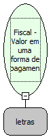

Descrição:

Retorna o valor acumulado em uma determinada forma de pagamento

Parâmetros:

1. Forma de pagamento

Retorno:

Valor acumulado em uma determinada forma de pagamento

Nome Real:

ebfBematechValuePaymentForm

Compatibilidade:

Cliente
