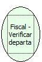

Descrição:

Retorna os departamentos e seus valores acumulados.

Parâmetros:

Não possui

Retorno:

os departamentos e seus valores acumulados.

Observações:

1. Na impressora fiscal YANCO, este retorno não existe

2. Essa função retorna as informações dos departamentos na seguinte ordem:

 1. Valor acumulado para cada departamento.........................: 20 bytes

 2. Valor com o número de vezes em que o departamento foi utilizado: 20 bytes

 3. Descrição do departamento......................................: 10 bytes

Nome Real:

ebfBematechFiscalVerifydepartment

Compatibilidade:

Cliente
