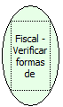

Descrição:

Retorna as formas de pagamento e seus valores acumulados.

Parâmetros:

Não possui

Retorno:

As formas de pagamento e seus valores acumulados

Observação:

Essa função retorna as informações das formas de pagamento na seguinte ordem:

1. Descricao da forma de pagamento.....................: 16 bytes

2. Valor acumulado (2 casas decimais)..................: 20 bytes

3. Valor recebido no último cupom (2 casas decimais)...: 20 bytes

4. Valor indicando se a forma foi usada para a emissão do cupom não fiscal vinculado (1 usado, 0 não usado): 1 byte

Nome Real:

ebfBematechFiscalVerifyPaymentForm

Compatibilidade:

Cliente
