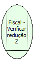

Descrição:

Verifica se a última Redução Z foi executada automáticamente na impressora

Parâmetros:

Não possui

Retorno:

1 - (um) Redução Z automática

0 - (zero) Redução Z por comando

Nome Real:

ebfBematechFiscalVerifyAutomaticReductionZ

Compatibilidade:

Cliente
