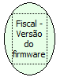

Descrição:

Retorna a versão do firmware da impressora.

Parâmetros:

Não possui

Retorno:

Versão do firmware da impressora

Observações:

1. Na impressora fiscal YANCO são retornados 2 (dois) bytes.

2. Nas impressoras fiscais MP-2000 TH FI, MP-6000 TH FI, MP-25 FI e MP-50 FI serão retornados os 4 primeiros caracteres de sua versão de firmware. A versão de firmware nestas impressoras tem o tamanho de 6 caracteres.

Nome Real:

ebfBematechFiscalFirmwareVersion

Compatibilidade:

Cliente
