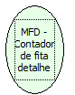

Descrição:

Retorna o número de vezes em que foi impressa a fita detalhe.

Parâmetros:

Não possui.

Retorno:

Contador de fita detalhe

Nome Real:

ebfBematechFiscalMFDAccountantRibbonDetail

Compatibilidade:

Cliente
