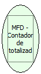

Descrição:

Retorna o número de vezes em que os totalizadores não sujeitos ao ICMS foram usados.

Parâmetros:

Não possui.

Retorno:

Número de totalizadores

Nome Real:

ebfBematechFiscalMFDAccountantTotalizerNoFiscal

Compatibilidade:

Cliente
