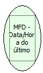

Descrição:

Retorna a data e hora do último documento armazenado na MFD no formato dd/mm/aa hh/mm/ss (sem barras e espaço).

Parâmetros:

Não possui

Retorno:

Data e hora

Nome Real:

ebfBematechFiscalMFDDateTimeLastDocument

Compatibilidade:

Cliente
