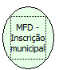

Descrição:

Retorna a incrição estadual do cliente cadatrada na impressora.

Parâmetros:

Não possui

Retorno:

Inscrição estadual

Nome Real:

ebfBematechFiscalMFDStateRegistration

Compatibilidade:

Cliente
