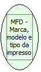

Descrição:

Retorna a marca, o modelo e o tipo da impressora.

Parâmetros:

Não possui

Retorno:

Lista de retorno

1. Marca

2. Modelo

3. Tipo

Nome Real:

ebfBematechFiscalMFDPrinterTypeMarkModel

Compatibilidade:

Cliente
